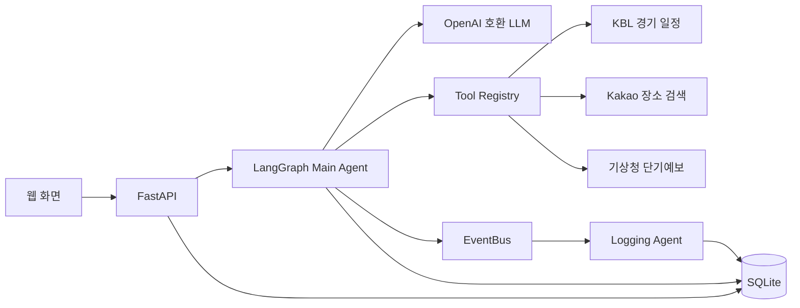
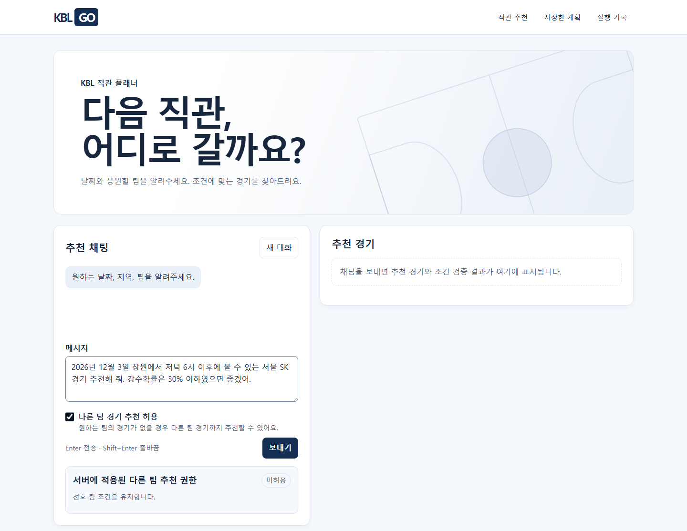
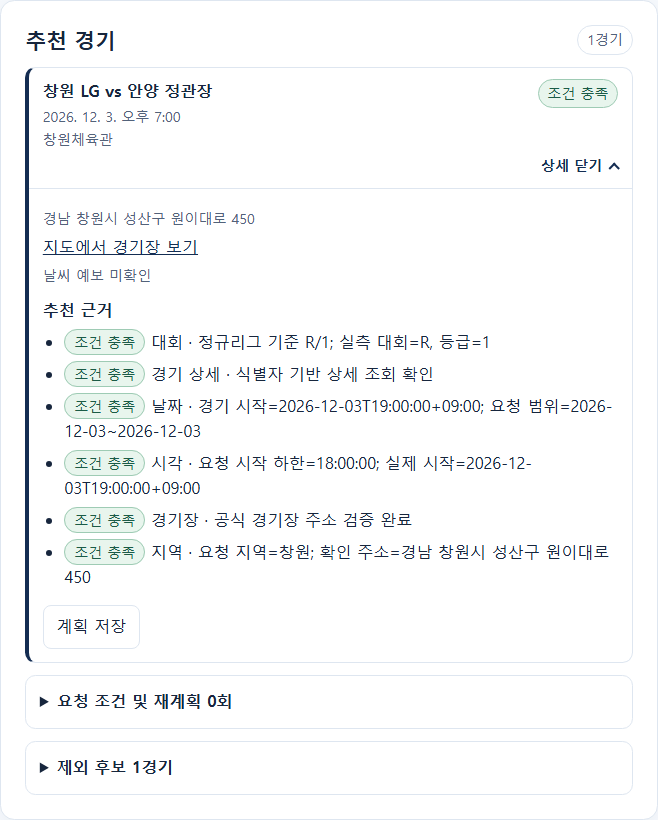
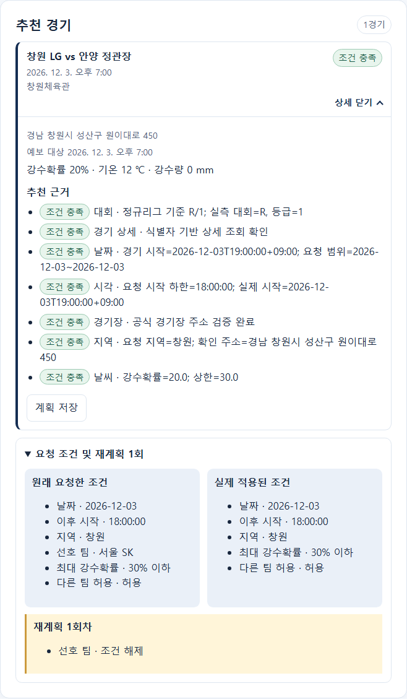
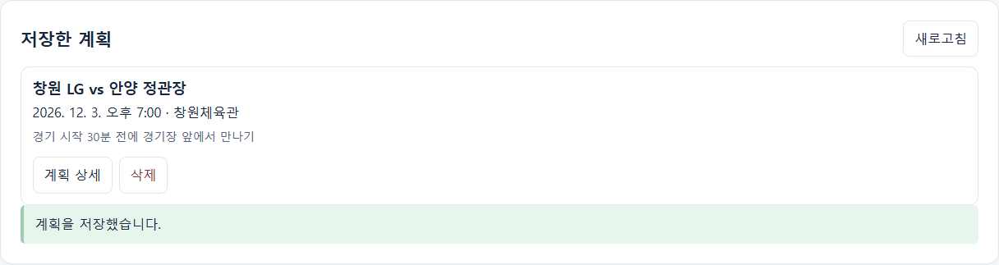
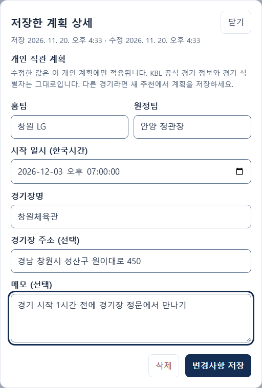
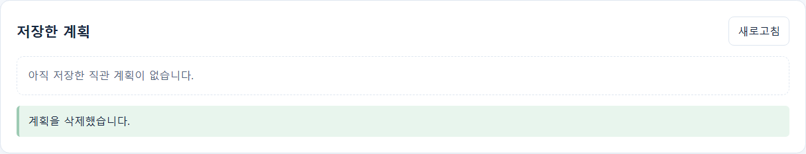
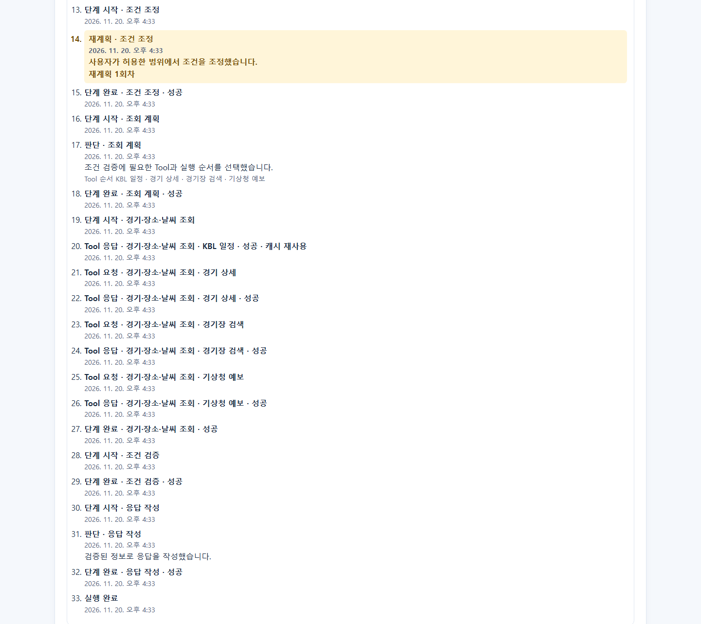

# KBL GO

KBL GO는 날짜, 지역, 선호 팀, 시작 시각, 강수 조건을 바탕으로 한국프로농구 직관 경기를 추천하는 AI 플래너다. 따로 확인해야 했던 경기 일정과 장소, 예보를 하나의 요청으로 조회하고, 조건별 추천 근거와 제외 이유를 보여 준다. 사용자가 허용한 범위에서 대안을 찾고, 선택한 경기를 개인 직관 계획으로 저장할 수 있다.

## 기술 스택과 구조

Python · FastAPI · Pydantic · LangGraph · SQLite · HTML · CSS · JavaScript. OpenAI 호환 LLM으로 요청을 분석하고, 외부 API에서 확인한 정보로 조건을 판정한다.



`analyze → plan → execute_tools → evaluate → respond` 순서로 실행한다. 인사와 날짜 확인 요청은 조회를 생략한다. 검증된 후보가 없고 허용된 대안이 남으면 `evaluate → replan → plan`으로 돌아간다. 최종 응답은 추천·제외 후보와 조건별 결과를 제공한다. [Agent 설계](docs/AGENT_DESIGN.md)

| Tool | 역할 |
| --- | --- |
| `search_kbl_games` | KBL에서 날짜 범위의 경기 ID와 일정 조회 |
| `get_kbl_game_detail` | 같은 ID의 경기 시각·장소·팀 확인 |
| `search_arena` | Kakao에서 경기장 후보의 주소·좌표·링크 조회 |
| `get_weather` | 확인한 경기장 좌표와 경기 시각의 기상청 단기예보 조회 |

KBL 웹 엔드포인트의 별도 사용 허가와 한도는 확인 중이다. Kakao 키워드 검색은 첫 활성화 앱의 일간 무료 쿼터 100,000건이 적용된다. 기상청 개발계정 트래픽은 포털 표기 10,000이며 출처표시가 필요하다. [출처·이용 조건·Tool 계약](docs/TOOL_SPEC.md)

## 조회·재계획과 저장 정책

- 정규리그는 확인된 대회 값 `R/1`로 판정한다. 지역은 검증된 경기장 주소, 강수 조건은 경기 시각과 일치하는 예보를 사용한다. 확인할 수 없는 조건은 미확인으로 표시한다.
- 체크박스나 명시적인 요청으로 허용한 팀·대체 날짜만 완화한다. 지역과 시각은 유지한다. 최대 3회까지 재계획하며, 실행 안에서 동일 Tool·인자의 결과를 재사용한다.
- 추천 카드에서 계획을 저장하고 목록에서 상세·편집·삭제할 수 있다. 경기 ID가 중복되면 409를 표시한다. 시각이 겹치면 저장하며 겹친 계획을 안내한다.
- 실행 로그는 세션·실행·이벤트 순서로 저장한다. 노드, Tool 호출·응답·지연, 캐시, LLM 판단·이유 및 재계획을 화면에서 확인할 수 있다. 로깅 구독자의 저장 오류는 대화 처리를 막지 않는다.

| FastAPI 경로 | 메서드 |
| --- | --- |
| `/api/health` | GET |
| `/api/chat` | POST |
| `/api/plans` | GET, POST |
| `/api/plans/{plan_id}` | GET, PATCH, DELETE |
| `/api/logs` | GET |
| `/api/logs/{session_id}` | GET, DELETE |

실행 중 `/docs`에서 Swagger를 연다. [API 명세](docs/API_SPEC.md)

## 설치 및 시연

```powershell
python -m venv .venv
.\.venv\Scripts\python.exe -m pip install -r requirements.txt
.\.venv\Scripts\python.exe -m uvicorn backend.main:app --reload
```

프로젝트 루트의 로컬 `.env`에 Kakao 개발자 콘솔의 `KAKAO_REST_API_KEY`, 공공데이터포털 단기예보 활용신청에서 받은 `KMA_SERVICE_KEY`를 설정한다. OpenAI 호환 LLM 연결에는 `OPENAI_API_KEY`, `OPENAI_BASE_URL`(보통 `/v1`까지), `OPENAI_MODEL`이 필요하다. 제공처에서 발급한 설정을 입력하고 서버를 재시작한다. 실제 연동 검증은 SSAFY GMS를 사용했다.

1. [웹 화면](http://127.0.0.1:8000/)에서 `2026-12-03 창원에서 오후 6시 이후 KBL 정규리그 경기 추천해 줘`처럼 예정 경기를 요청한다.
2. 추천 카드를 펼쳐 장소와 충족 조건을 확인한다. 선호 팀이 없는 경우 대안을 허용하려면 다른 팀 추천 체크박스를 선택한다.
3. 계획을 저장한 뒤 목록에서 경기명·시각·장소·메모를 편집하고 상세에서 결과를 확인한다. 실행 기록에서 Tool 호출과 재계획 흐름을 확인한다.

## 화면 캡처

로컬 FastAPI 앱을 1440px 데스크톱 Chromium에서 실행했다. 시연에는 임시 SQLite를 사용했다.



**실제 추천.** 2026년 12월 3일 창원에서 저녁 6시 이후 열리는 정규리그 경기를 요청했다. GMS·KBL·Kakao 연동으로 창원 LG 대 안양 정관장 경기와 창원체육관을 확인했다.



**Mock 시연.** 같은 날 창원의 서울 SK 경기를 우선 찾고, 다른 팀 추천을 허용했다. 팀 조건을 완화해 창원 LG 경기를 추천하고, 예시 강수확률 20%로 날씨 조건을 확인했다. 화면의 예보 값은 시연용이다. 이어서 경기 계획을 저장하고 메모를 편집한 뒤 삭제했다.











## 검증 결과와 남은 항목

- 전체 pytest 202개 통과. `pip check`, `node --check frontend/app.js`, `git diff --check`를 실행했다.
- Mock 대표 요청 5종에서 정상 추천, 재계획, 3회 상한, Tool 실패, Tool 없는 대화를 확인했다. Chromium에서 세션 복원과 계획 저장·수정·삭제, 중복 409, 로그 조회·삭제를 확인했다.
- 실제 GMS·KBL·Kakao 연동으로 창원체육관 경기 1건을 추천했다. 기상청 API는 별도의 현재 시각 조회에서 HTTP 200과 서비스 코드 00을 반환했다. 실제 추천 1건의 처리 시간은 19.60초로 반복 측정과 사용성 판정이 남았다.
- 적용 대상 필수 체크 항목은 26개 중 PASS 23개, BLOCKED 3개다. KBL API 이용 허가·호출 한도와 실연동 처리 시간 검증이 남아 제출 판정을 보류했다. 선택 심화 항목은 적용하지 않았다. 참고할 예보가 아직 없거나 장소를 검증할 수 없으면 관련 제약은 미확인으로 남는다. 앱은 로컬 사용을 전제로 한다. [요구사항](docs/REQUIREMENTS.md) · [체크리스트](docs/CHECKLIST.md) · [검증 기록](docs/VERIFICATION.md)

## 프로젝트 구조

```text
backend/
  agent/    LangGraph, 세션, 이벤트, 로깅 구독자
  tools/    외부 API와 Tool Registry
  main.py   FastAPI 앱 및 채팅 라우트
  plans.py  계획 API
  logs.py   실행 로그 API
frontend/   채팅·계획·타임라인 화면
scripts/    외부 API 검증 스크립트
tests/      계약·에이전트·SQLite·UI 제공 경로 회귀 테스트
docs/       상세 명세, 화면 캡처, 실행 로그와 검증 기록
```

[프로젝트 기획](docs/PROJECT_PLAN.md) · [정상 실행 로그](docs/log-samples/normal.json) · [재계획 실행 로그](docs/log-samples/replan.json)
