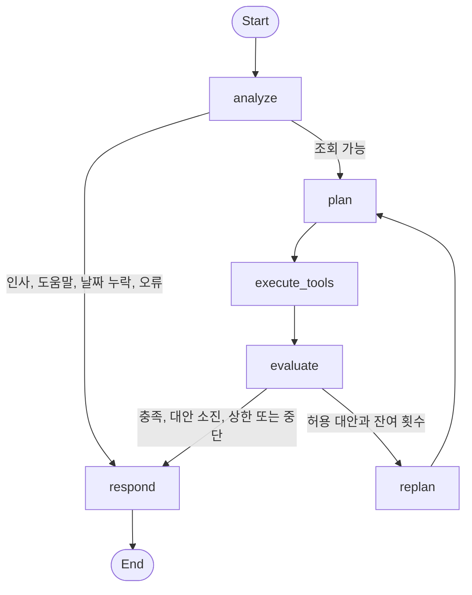

# Agent 설계

[그래프 구현](../backend/agent/graph.py)은 요청별 `AgentState`를 생성한다. 상태에는 세션·실행 ID, 원본·현재 조건, 이전 조건과 검증된 권한, 작업 순서, Tool 캐시, 경기·상세·장소·예보, 추천·제외, 오류·경고, 재계획 횟수와 기록이 들어간다. [상태 모델](../backend/agent/state.py)

| 노드 | 입력과 처리 | 출력 |
| --- | --- | --- |
| analyze | 사용자 문장, 이전 조건, 체크박스. JSON 분석 결과를 검증하고 변경 필드에만 반영 | 의도, 요청 조건, 허용 범위 |
| plan | 조건과 Tool 의존성을 조합 | 실행 순서와 판단 이벤트 |
| execute_tools | 경기 목록 → 상세 → 장소 → 필요 시 날씨 | 정규화 결과, 실패 코드, 캐시 여부 |
| evaluate | 날짜·경기 시각·팀·검증된 장소·예보를 비교 | 충족·불충족·미확인, 이유 |
| replan | 허용된 팀 해제 또는 명시된 대체 날짜 | 변경 이력, 최대 3회 |
| respond | 평가 결과와 허용된 안내 문구 | 추천, 제외, 근거, 실패 안내 |

동일 실행에서 Tool 이름과 동일 인자의 성공·실패 결과를 재사용한다. 인증·외부 장애·타임아웃 등은 조건 완화로 해결하지 않는다. LLM은 분석, 계획, 응답 안내의 허용 범위 안에서 동작한다. 경기·주소·강수확률과 최종 근거는 Tool 결과를 사용한다.

권한은 체크박스의 명시적인 true/false, 지원되는 직접 허용·철회 문장, 같은 세션의 검증 이력으로 판단한다. 모호하면 확인을 요청한다. SQLite 세션은 조건·요약·권한을 보관한다. 세션 ID가 바뀌면 별도 맥락을 사용한다. 재계획의 일시적인 완화는 원래 조건을 바꾸지 않는다.

EventBus는 실행·노드·LLM 판단·Tool 요청과 응답 이벤트를 발행한다. 구독자인 Logging Agent가 LLM 호출 없이 안전한 이벤트를 세션·실행별 SQLite에 저장한다. 구독이 없거나 저장에 실패해도 Agent 응답을 계속한다. [이벤트](../backend/agent/events.py) · [구독자](../backend/agent/logging.py)
